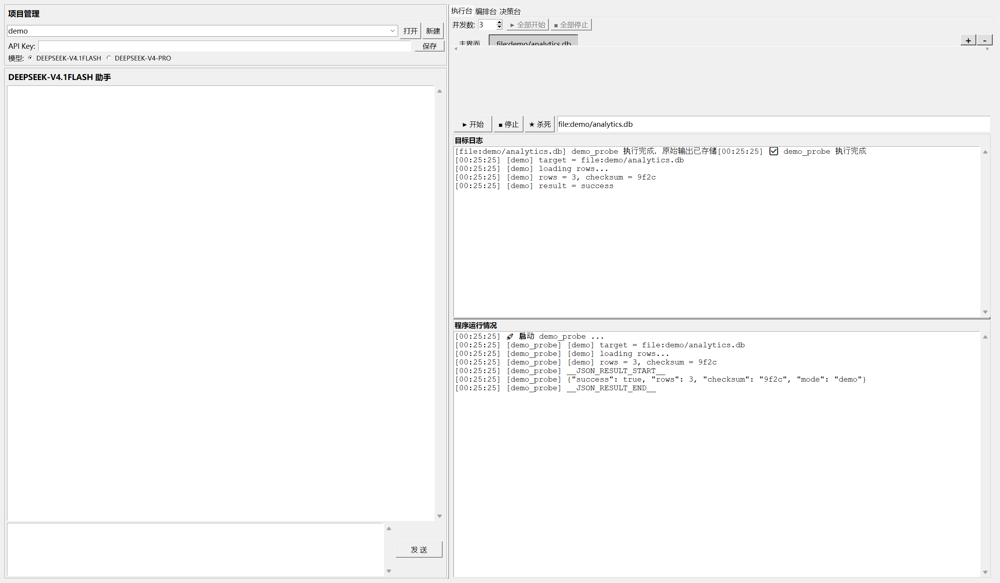
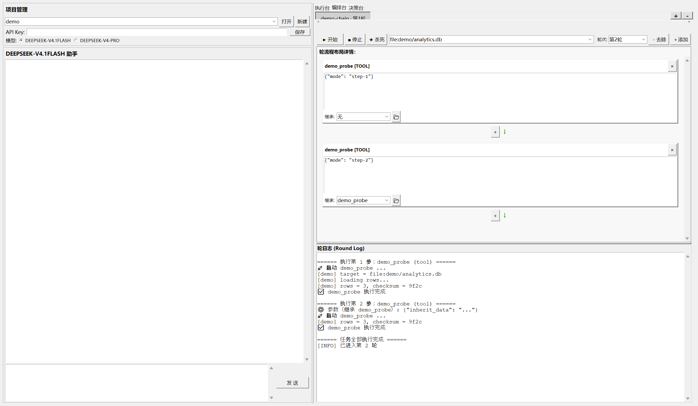
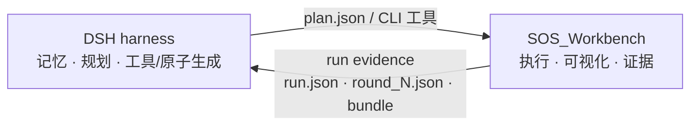

# SOS_Workbench

**DSH 下游的可视化执行与轮次编排工作台。**

[](https://www.python.org/)
[](LICENSE)
[](test/)

> 当前版本 **0.1.0**。定位：DSH 负责想和记，SOS_Workbench 负责跑和留证据。

SOS_Workbench 不是另一个 agent，也不是第二个 harness。它只做一件事：

> **把 DSH（或人）给出的计划，展开成可人工触发的步骤链，逐进程执行，并留下可回溯的执行证据。**



*执行台：目标、实时日志、结构化结果。图中的 `demo_probe` 仅为截图演示，不随发行版提供；发行版示例为 `sqlite_query` 与 `http_probe`。*



*编排台：步骤盒、参数继承、轮次日志。图中的 `demo_probe` 仅为截图演示，不随发行版提供；发行版示例为 `sqlite_query` 与 `http_probe`。*

---

## 为什么不是“另一个 harness”

DSH 已经有记忆、规划和工具生成能力。SOS_Workbench 不重复这些，它只补齐下游的执行与证据：

| | DSH | SOS_Workbench |
|---|---|---|
| 负责 | 记忆、上下文、规划、工具/原子生成 | 执行、可视化、过程留痕 |
| 数据 | agent memory | **run evidence** |
| 形态 | 会话 / 计划 | `session.log` · `structured_logs/` · `round_N.json` · `runs/` |
| 目标 | 让下一步更聪明 | 让这一步可复盘、可比较、可交给下一步 |

SOS_Workbench 不维护第二套记忆。它存的是**这一次执行发生了什么**：目标、参数（脱敏后）、耗时、退出码、输出、失败原因、工具/skill 版本、审批、轮次快照。

---

## 章鱼龙虾化

| 隐喻 | 对应 |
|---|---|
| **章鱼的腕足** | 可插拔的原子工具 + 多级 skill，多目标、多步骤，伸向不同 CLI |
| **龙虾的甲壳** | 每一轮的硬快照、日志、证据链，可回溯 |
| **中枢与记忆** | DSH：计划、上下文、记忆、工具生成 |
| **外骨骼** | SOS_Workbench：把腕足伸出去，把壳留下来 |

一句话：

> **DSH 想，SOS 跑；DSH 记，SOS 留证据。**

---

## 架构



CLI、桌面 UI、测试共用同一套执行核：

```text
cli.py ──▶ core/headless.py ──▶ phases/phase2.py ──▶ core/tool_runner.py
ui/    ──▶ app.py            ──▶ phases/phase2.py ──▶ core/tool_runner.py
```

---

## 主要能力

### 1. 执行核

- **进程契约**：`工具 --project-dir X --target Y --config Z`，语言无关（`.py/.pyz/.exe/.bat/.cmd/.ps1/.sh/.js`）。
- **target 不透明**：域名、DSN、本地路径、工单号都可以，平台不解析领域语义。
- **线性编排**：步骤盒、参数 JSON、`inherit_from` 上一步结果。
- **执行控制**：并发上限、单步超时（默认 900s）、进程树强杀。
- **凭证**：`{"$secret": "ENV_NAME"}`，日志与快照使用脱敏副本。
- **轮次沉淀**：每步独立快照，每轮 `round_N.json` 汇总。

### 2. CLI（给 DSH 的入口）

```bash
python cli.py tools list --json
python cli.py plan validate --plan plan.json --json

python cli.py run --plan plan.json --project demo --target example.com --json
python cli.py run --plan plan.json --project demo --target example.com --detach --json

python cli.py runs show --run-id <id> --json
python cli.py runs logs --run-id <id> --follow
python cli.py runs cancel --run-id <id> --by human
python cli.py runs verify --run-id <id> --json
python cli.py runs bundle --run-id <id> --out bundle.json
```

Windows 下可使用 `sos_workbench.cmd`：

```bat
sos_workbench.cmd tools list --json
```

约定：

- `--json` 时 **stdout 只输出 JSON**，日志走 stderr。
- 退出码：`0` 成功，`2` 参数/计划/scope 错误，`3` 执行失败。
- `run` 默认同步；`--detach` 后台执行，返回 `run_id`，用 `runs show/logs/cancel` 管理。
- 运行数据可用 `SOS_DATA_DIR` 或 `--data-dir` 隔离。

完整命令见 [docs/CLI.md](docs/CLI.md)。

### 3. 高风险护栏

```bash
python cli.py run \
  --plan plan.json \
  --target example.com \
  --scope scope.json \
  --allow-destructive \
  --approved-by alice \
  --actor dsh \
  --json
```

scope 示例：

```json
{
  "targets": ["example.com"],
  "tools": ["http_probe", "sqlite_query"],
  "allow_destructive": false,
  "require_manifest": true,
  "max_steps": 20,
  "max_duration": 600
}
```

- target/tool 不在 scope → `scope_denied`
- 步骤超预算 → `budget_exceeded`
- 破坏性工具未解锁 → `destructive_locked`
- 破坏性动作没有审批人 → `approval_required`
- `actor`、scope、预算、审批全部写入 run 记录
- `max_requests` 当前只记录，由工具自己遵守

### 4. 证据 v2

`run.json` 包含：

- `parent_run_id`、`plan_version`
- `model_id`、`model_prompt_hash`
- `actor`、`scope`、`budget`、`approvals`
- `tool_versions` / `skill_versions` 及开始/结束 hash
- `tool_frozen` / `skill_frozen`：运行期版本变化检测
- `evidence_chain`：每一步的 `prev` / `hash`
- `evidence_root`：计划、工具、skill、审批、状态、证据链的根
- `signature`：设置 `SOS_EVIDENCE_KEY` 时生成 HMAC-SHA256
- `runs verify`：校验链、root、签名

说明：当前签名是 HMAC 共享密钥，不是非对称签名；要做第三方可验证，需要 Ed25519/公钥。

### 5. 工具 / skill 入库流水线

```bash
python cli.py tools stage --path my_tool.py --name my_tool --risk read_only --json
python cli.py tools approve --name my_tool --by alice --dry-run-confirmed --json

python cli.py skills stage --path my_skill.py --name my_skill --category phase3 --json
python cli.py skills approve --name my_skill --by alice --dry-run-confirmed --json
```

流程：

```text
staging/ → 编译 + AST 静态检查 → 人工只读 dry-run 确认
        → approve --by → hash/version 注册
        → 托管 tools/ 或 skills/{category}
```

- 未审批代码不会自动执行。
- `--strict` 把静态检查 finding 当成拒绝理由。
- 运行期会检测工具/skill hash 是否变化。

### 6. 桌面 UI

- **执行台**：多目标页签、实时日志、结构化结果。
- **编排台**：步骤盒、参数、继承、轮次日志。
- **决策台**：可选本地计划控制台，不参与默认 DSH 工作流。

---

## 典型工作流

1. **DSH 侧**：产出计划、工具或原子，决定这一轮要做什么。
2. **SOS 侧**：导入计划，选目标，人工触发；需要长任务时用 `--detach`。
3. **回到 DSH**：把 `run.json`、`round_N.json`、`latest/`、`session.log` 或 `bundle.json` 作为执行证据，交给下一轮规划或复盘。

当前是**工作流级搭配**，不是代码级 DSH 插件：SOS_Workbench 不 import DSH，也不直接读写 DSH 的记忆。接口是 CLI；MCP 是可选增强，不是前置条件。

---

## 快速开始

### 环境

- Windows 10/11
- Python 3.10+
- Tk 随 Python 自带

```bash
pip install -r requirements.txt
python main.py
```

### 跑一条链

1. 左侧「项目管理」新建项目，填项目名与主标识。
2. 「执行台」添加目标。target 是**不透明字符串**：域名、DSN、本地路径、工单号都可以。
3. 把符合契约的可执行文件放进 `external_tools/`，重启即可被发现。
4. 「编排台」新建任务 → 添加工具/技能 → 填参数 JSON → 选目标 → 点「开始」。
5. 在轮日志和 `storage/` 下查看过程与快照。

最小示例见 [`external_tools/sqlite_query.py`](external_tools/sqlite_query.py)，完整契约见 [对齐方法.txt](对齐方法.txt)。

---

## 计划与证据契约

### 计划

```text
storage/round/{任务名}/
├── plan.json          # 步骤链
└── task_config.json   # 任务名 / 当前轮次 / 步骤链
```

`plan.json` 最小形态：

```json
{
  "tools": [
    {
      "name": "sqlite_query",
      "type": "tool",
      "params": "{\"sql\": \"select 1\"}",
      "inherit_from": null,
      "inherit_file": null
    }
  ]
}
```

`inherit_from` 会注入上一步结果：

```json
{
  "success": true,
  "duration": 0.42,
  "output": "工具输出的文本",
  "output_lines": ["...", "..."],
  "result": { "工具 stdout 的 JSON 结果块": "如果有" }
}
```

### 执行证据

```text
storage/projects/{项目}/
├── session.log
├── structured_logs/{slug}/{工具}.jsonl
└── latest/{slug}/round_N/{工具}_{序号}.json

storage/round/{任务}/{任务}_round_N.json
storage/runs/{run_id}/run.json
storage/runs/{run_id}/plan.json
storage/runs/{run_id}/spec.json
```

- `runs/{run_id}/run.json`：CLI run 记录，含计划、scope、审批、actor、步骤结果、hash、证据链、签名。
- `round_N.json`：这一轮所有步骤的结果汇总，是 L3 读取、也可交给 DSH 的稳定契约。
- `latest/`：每一步的独立快照。
- `structured_logs/`：按 target/工具拆分的 JSONL 事件。
- `session.log`：全量文本日志。

`runs bundle` 会打成 `sos.run_bundle/v1`，包含 run 记录、轮次汇总和 artifacts 的 `sha256`。

---

## 测试

```bash
python test/conformance.py          # 49 项：契约 / 凭证 / 超时 / 并发 / 日志 / 环境隔离
python test/integration_phase2.py   # 19 项：编排链路 / 轮次产物 / 只读拦截 / 递归嵌套
python test/inheritance.py          # 5 项：inherit_from 写回与无继承回归
python test/cli_smoke.py            # 21 项：CLI 工具/计划/run/bundle/失败契约
python test/cli_advanced.py         # 24 项：async/cancel/follow、scope、审批、证据链、入库
```

五个测试都不需要 GUI、不需要外网，全部在临时目录内运行。CI 在 Windows 上跑 Python 3.10 / 3.12（[.github/workflows/test.yml](.github/workflows/test.yml)）。

---

## 安全边界

- 工具以**当前用户权限**运行，**没有沙箱**。只接入你信任的工具与技能。
- `external_tools/`、`skills/`、`SOS_DATA_DIR/tools|skills` 里的代码会被本机执行。
- API Key 只用于进程内的模型客户端，不注入工具子进程环境。
- `{"$secret": "ENV"}` 只保证 SOS 自己的日志/快照使用脱敏副本；工具自身的 stderr 仍可能输出敏感内容。
- 模型动作（`ENABLE_MODEL_ACTIONS`）、自动模式（`ENABLE_AUTO_MODE`）和 `shell_exec`（`ENABLE_SHELL_ACTION`）默认关闭。
- 建议用 `--scope` 限制 target/tools/budget；破坏性工具需要 `--allow-destructive` + `--approved-by`。
- DSH 生成的工具/skill 应先 `stage`、静态检查、只读 dry-run，再由人 `approve --by`。
- 设置 `SOS_EVIDENCE_KEY` 后 run 记录带 HMAC 签名，`runs verify` 可校验证据链。
- 本项目是单机、单用户工具，没有鉴权、多租户隔离或服务端边界。

---

## 不做什么

- 不做多用户、鉴权、分布式执行。
- 不做 DAG、条件分支、定时调度、依赖图。
- 不做内置的数据库/HTTP/扫描“功能”；这些应该由工具提供。
- 不做 DSH 的记忆、规划或模型路由。
- 不承诺跨平台；当前只在 Windows 上验证。

---

## 已知限制

- 只有线性步骤链，没有分支、条件、重试、DAG；L2 单链步骤默认串行。
- 同一 `Skill` 实例不能被多个目标并发调用（实例级状态）。
- 递归嵌套尚未实现深度上限与环检测，见 [递归标准.txt](递归标准.txt) 的 G1–G6。
- `--detach` worker 异常退出时，`runs cancel` 会尝试强杀；极端情况下仍可能需要手工清理。
- `max_requests` 只记录，不做请求计数。
- CLI 的 skill 步骤要求技能遵守 `BaseSkill` 生命周期并写终态快照。
- 模型 ID 与线上 API 能力需要在发布前用真实 Key 做一次 smoke test。

---

## 路线图

- [x] 定位重构：DSH 下游可视化执行工作台
- [x] CLI：`tools` / `skills` / `plan` / `run` / `runs`
- [x] 异步执行：`run --detach` / `runs cancel` / `runs logs --follow`
- [x] 高风险护栏：scope、预算、破坏性锁、审批、actor
- [x] 证据 v2：hash chain、HMAC、`runs verify`
- [x] 工具/skill 入库流水线
- [ ] MCP 适配层（可选，暂缓）
- [ ] 阶段 2 链内并发（需要 `parallel_group` / `depends_on`，暂缓）
- [ ] DSH 代码级适配层（当前 CLI 工作流级）
- [ ] 非对称签名 / 外部可验证证据

---

## 文档

| 文件 | 内容 |
|---|---|
| [docs/CLI.md](docs/CLI.md) | CLI 命令、计划格式、run 记录与证据包 |
| [docs/RELEASE.md](docs/RELEASE.md) | 发布检查、tag、源码包与截图要求 |
| [项目结构.txt](项目结构.txt) | 目录、模块职责、调用链、依赖方向 |
| [对齐方法.txt](对齐方法.txt) | 工具/技能接入契约、参数传递、模板、自检清单 |
| [递归标准.txt](递归标准.txt) | 父子任务嵌套：契约、状态机、终止条件、已知缺口 |
| [轮次skill规则.txt](轮次skill规则.txt) | 二级技能模板与生命周期 |
| [日志结构.txt](日志结构.txt) | 三层日志的实际落盘位置与格式 |
| [CHANGELOG.md](CHANGELOG.md) | 版本变更记录 |

## 参与

- 开发与提交规范：[CONTRIBUTING.md](CONTRIBUTING.md)
- 安全问题与信任边界：[SECURITY.md](SECURITY.md)
- 行为准则：[CODE_OF_CONDUCT.md](CODE_OF_CONDUCT.md)

## 合规

SOS_Workbench 本身不包含任何攻击能力，其行为完全取决于接入的工具。
请确保对接入的每一个工具、每一个 target 都拥有合法授权，并遵守所在地法律法规与目标系统的使用条款。

## License

[MIT](LICENSE)
